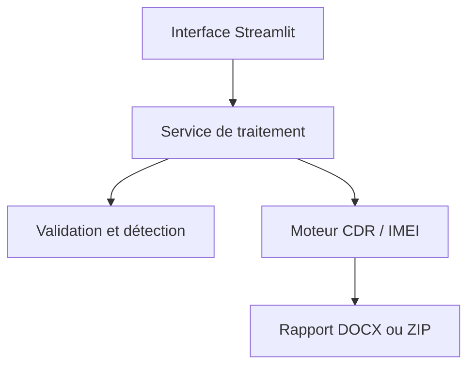

[](https://github.com/laicpanghebeko-lab/cdr-insight-studio/actions/workflows/ci.yml)


# CDR Insight Studio

CDR Insight Studio transforme des listings télécom PDF hétérogènes en rapports Word structurés. Le projet regroupe un moteur de parsing déterministe, une couche de validation bornée et une interface Streamlit autonome — sans base de données, CRM ni service téléphonique.

Le dépôt a été conçu comme un projet de portfolio complet : architecture en couches, typage Python, tests synthétiques, contrôle qualité continu, conteneur non-root et documentation de confidentialité.

## Capacités

- détection automatique des listings basés sur un numéro ou un IMEI ;
- prise en charge de plusieurs mises en page PDF, dont WinDev et PDFKit ;
- normalisation des appels, SMS/data, correspondants, cellules et zones ;
- calcul des échanges bidirectionnels, durées, jours distincts et zones dominantes ;
- analyse de chronologie des utilisateurs partageant un IMEI ;
- génération de rapports DOCX unitaires ou combinés ;
- limites sur le nombre, la taille et le volume de pages des fichiers ;
- enrichissement SerpAPI explicitement optionnel et désactivé par défaut ;
- traitement temporaire sans stockage applicatif persistant.

## Architecture



La séparation rend le moteur réutilisable depuis Streamlit, des tests ou une future API. Voir [la documentation d’architecture](docs/architecture.md).

## Démarrage rapide

Prérequis : Python 3.11 ou 3.12.

```bash
git clone https://github.com/laicpanghebeko-lab/cdr-insight-studio.git
cd cdr-insight-studio
python -m venv .venv
source .venv/bin/activate  # Windows : .venv\Scripts\activate
python -m pip install -e ".[dev]"
streamlit run streamlit_app.py
```

L’application propose un PDF entièrement synthétique pour tester le parcours sans données personnelles.

## Docker

```bash
docker build -t cdr-insight-studio .
docker run --rm -p 8501:8501 cdr-insight-studio
```

Ouvrez ensuite `http://localhost:8501`.

## Déploiement Streamlit Community Cloud

1. créez une application depuis ce dépôt ;
2. sélectionnez `streamlit_app.py` comme point d’entrée ;
3. utilisez Python 3.12 ;
4. n’ajoutez `SERPAPI_API_KEY` aux secrets que si l’enrichissement web est nécessaire.

Le fichier `requirements.txt` installe le package local et ses dépendances déclarées dans `pyproject.toml`.

## Utilisation comme package Python

```python
from cdr_insight.service import ProcessingOptions, Upload, process_uploads

result = process_uploads(
    [Upload("listing.pdf", pdf_bytes)],
    ProcessingOptions(listing_type="auto", output_mode="combined"),
)
result_path.write_bytes(result.content)
```

## Qualité et tests

```bash
ruff check .
pytest --cov=cdr_insight --cov-report=term-missing
python -m compileall -q src streamlit_app.py
```

Les tests n’embarquent ni véritables noms, ni numéros clients, ni documents opérateur. GitHub Actions exécute les contrôles sur Python 3.11 et 3.12.

## Confidentialité et usage responsable

Les listings télécom peuvent contenir des données personnelles particulièrement sensibles. Ce logiciel doit uniquement être utilisé sur des documents dont vous avez l’autorisation de traitement. Le dépôt ne fournit aucune donnée réelle et ne persiste pas les fichiers analysés. Un déploiement distant reste un serveur : vérifiez sa juridiction, ses journaux et sa politique de rétention avant d’y déposer des documents sensibles.

La recherche web est désactivée par défaut. Lorsqu’elle est activée, des noms ou numéros peuvent être transmis à SerpAPI ; l’interface le signale avant activation.

## Limites connues

- les PDF image nécessitent un OCR préalable ;
- les formats opérateur inconnus peuvent demander un adaptateur supplémentaire ;
- les résultats sont des aides à l’analyse et doivent être vérifiés par un humain ;
- ce projet ne remplace ni un avis juridique ni une procédure de preuve numérique.

## Licence

Code visible pour évaluation professionnelle et apprentissage non commercial. Voir [LICENSE](LICENSE). Pour une licence commerciale ou une autre forme de réutilisation, contactez le propriétaire du dépôt.
