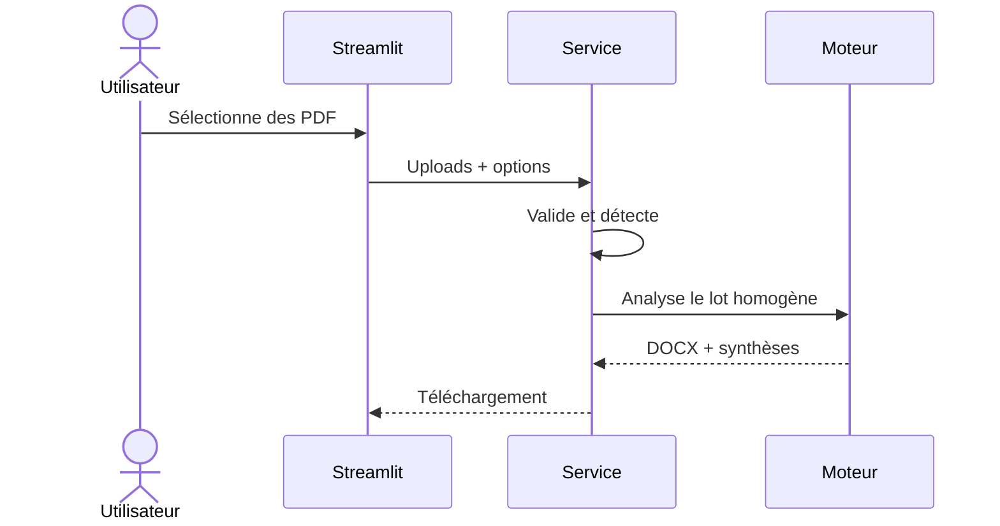

# Architecture

CDR Insight Studio suit une architecture en trois couches. Le moteur ne dépend pas de Streamlit, ce qui permet de le tester et de le réutiliser sans interface graphique.

| Couche | Fichiers | Responsabilité |
|---|---|---|
| Interface | `streamlit_app.py` | Saisie, paramètres, statut et téléchargement |
| Application | `cdr_insight/service.py` | Limites, classification, orchestration et sorties |
| Domaine | `cdr_insight/engine.py` | Parsing PDF, normalisation, analyse et DOCX |

## Flux de traitement

## Frontières de sécurité

- seuls les PDF sont acceptés ; la signature, la taille et le nombre de pages sont vérifiés ;
- les noms sont normalisés avant toute écriture temporaire ;
- les lots téléphone/IMEI mélangés sont refusés ;
- les fichiers temporaires sont contenus dans `TemporaryDirectory` ;
- aucune base de données n’est nécessaire ;
- les appels web ne sont possibles qu’après activation explicite et présence d’une clé.

## Extension d’un format

Un nouvel adaptateur doit produire les mêmes objets `CallRow`, `SubscriberInfo` et `IdentificationRecord`. La logique d’analyse et la génération de rapports restent alors communes à tous les formats.
